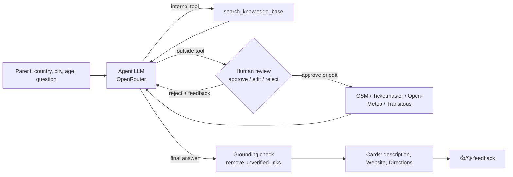

# 🎈 Kids Outing Finder

[](https://github.com/NMH1988/kids-events-finder/actions/workflows/ci.yml)

> **Showcase:** _add the link from showcase.turingcollege.com here before booking the review_
> **Turing College · AI Engineering Capstone** · Case 2 (AI agent for task automation) with an advanced RAG component (Case 1)

## Goal, problem and how it works

**Goal.** Help parents in Germany, the United Kingdom and the United States find a good outing for their child in under a minute: a short description, the official website and Google Maps directions for each suggestion. In Germany, the app also plans a **day trip by regional train within a fixed budget**, for families with or without a Deutschlandticket.

**Problem (SCR).**
- *Situation:* parents plan weekend and holiday activities for their children all the time.
- *Complication:* the information is spread over museum sites, event platforms, maps and weather apps. General chatbots invent places, links and opening times, which is risky when a family travels with small children.
- *Resolution:* an AI agent that searches a curated knowledge base with advanced RAG, checks live data (events, nearby places, weather) only after the parent approves each outside call, and removes any link that did not come from a real tool result.

**How it works.** The parent picks a country and city from the dropdowns, the children's age groups ("Child 1", "Child 2"; no names or exact ages), and asks a question in any language. A LangGraph agent chooses tools:

| Tool | Data | Approval needed |
|---|---|---|
| `search_knowledge_base` | Curated places (advanced RAG over Chroma + BM25) | No: stays inside the app |
| `find_nearby_places` | OpenStreetMap (Overpass API) | Yes |
| `search_family_events` | Ticketmaster Discovery API, family events | Yes |
| `get_weather_forecast` | Open-Meteo | Yes |
| `find_train_connection` | Transitous journey planner, regional trains only (DE) | Yes |
| `compare_train_tickets` | The app's fare table (Deutschlandticket, Länder-Tickets, Quer-durchs-Land) | No: calculated in code |
| `check_budget` | Costs added up in code | Yes: the parent fills in prices the app cannot know |

### Budget day trips (Germany)

Switch on **💶 Budget day trip by train** in the sidebar and enter the budget, the number of adults and how many travellers aged 15+ hold a Deutschlandticket; the children's age groups come from the sidebar. The agent picks a destination, finds regional train journeys there and back, compares tickets, checks the weather at the destination and runs a budget check.

- **Money is never calculated by the model.** Ticket rules live in `data/fares.json` (copied from bahn.de with a source link and the date checked) and `src/fares.py` applies them: children under 6 ride free, up to 3 children aged 6-14 ride free on most Länder-Tickets, the Deutschlandticket does not include children aged 6-14, and many day tickets start at 9:00 on weekdays. Example: two parents with a Deutschlandticket and children aged 8 and 10 pay 34 EUR for a 1-person Bayern-Ticket that takes the children along, not 44 EUR for a 2-person one.
- **Prices with no open source (entry fees, food) are not guessed.** The agent leaves them empty and the parent fills them in at the approval step, in an editable table; `src/budget.py` adds everything up.
- **Live journeys:** Transitous returns the current timetable and, where operators publish live data, delays and cancellations.

Before an outside call runs, the app pauses (**human in the loop**): the parent sees what will be sent and can **approve**, **edit the arguments** or **reject with feedback**. The final answer passes a **grounding check** that removes any link not found in a tool result. Parents rate answers with 👍/👎, which feeds the evaluation. A **Browse** tab shows the curated places as cards without any model call.



### Advanced RAG pipeline

1. **Multi-query rewriting:** a small LLM (`gpt-5-nano`) turns the question into three English search queries. This also handles Vietnamese or German questions.
2. **Metadata filtering:** only places in the chosen country and city (or day trips from it), suitable for every child's age group, and indoors when asked.
3. **Hybrid search:** dense vector search (Chroma, `qwen3-embedding-8b` via OpenRouter) and BM25 keyword search for every query.
4. **Reciprocal Rank Fusion** merges all rankings.
5. **Optional LLM reranking** of the top candidates (toggle in the sidebar).

`scripts/evaluate_retrieval.py` compares BM25, dense, hybrid, hybrid + multi-query and hybrid + multi-query + rerank on `data/eval_questions.json` (hit rate@5 and MRR).

## Tech stack

Python 3.14 · Streamlit · LangChain / LangGraph (`interrupt`, checkpointer, `ToolNode`) · OpenRouter (`openai/gpt-5-mini` agent, `gpt-5-nano` helper, `qwen/qwen3-embedding-8b` embeddings) · ChromaDB (embedded) · rank-bm25 · pytest · ruff

## Run it locally

```powershell
python -m venv .venv
.venv\Scripts\python.exe -m pip install -e ".[dev]"
copy .streamlit\secrets.toml.example .streamlit\secrets.toml   # then add your keys
.venv\Scripts\python.exe -m scripts.build_index                 # embeds the knowledge base
.venv\Scripts\streamlit.exe run app.py
```

- `OPENROUTER_API_KEY` is required for the chat and the index. `TICKETMASTER_API_KEY` is optional (free at developer.ticketmaster.com); without it, live event search is off.
- Without any key, the Browse tab still works.

## Tests and evaluation

```powershell
.venv\Scripts\python.exe -m pytest -q          # 1249 offline tests: LLM and network calls are faked
.venv\Scripts\ruff.exe check .
.venv\Scripts\python.exe -m scripts.evaluate_retrieval   # retrieval variants: hit@5, MRR
.venv\Scripts\python.exe -m scripts.evaluate_agent --judge   # grounded rate, relevance, wrong-country rate, latency, tokens, LLM judge
.venv\Scripts\python.exe -m scripts.evaluate_agent --red-team   # safety cases: privacy block, injection, development and urgency claims
.venv\Scripts\python.exe -m scripts.check_links           # are the curated websites still online?
```

Results and how to read them: [docs/EVALUATION.md](docs/EVALUATION.md).

## Ethics, privacy and safety

Summary (details in [docs/ETHICS.md](docs/ETHICS.md)):
- **No invented places:** the prompt allows only places from tool results, and the code removes any link that no tool returned.
- **Human oversight:** every call to an outside service needs the parent's approval by default.
- **Child privacy:** children are only "Child 1", "Child 2" with an age group, never names or exact ages; no health data; outside services receive only town names or coordinates, country, dates and category. Rules every change must follow: [docs/LEGAL_COMPLIANCE.md](docs/LEGAL_COMPLIANCE.md).
- **Transparency:** the page says the suggestions are AI-generated and must be checked on the official website. Every answer shows which tools ran and whether all links were verified.
- **Bias:** ticketed events dominate commercial APIs, so the knowledge base includes free places and the agent can search parks and playgrounds.

## Project structure

```
app.py                 Streamlit entry point (composes views/)
views/                 sidebar, chat (HITL panel, feedback), browse, about
src/agent/             LangGraph graph (agent, human_review, tools, grounding) and turn runner
src/rag/               Chroma index and the advanced retriever
src/tools/             tool schemas (validated) and external service calls
src/grounding.py       link verification
src/knowledge.py       curated knowledge base model and filters
src/fares.py           regional train ticket comparison (rules from data/fares.json)
src/budget.py          trip budget check
src/prompts/           system prompt
data/                  knowledge_base.json, fares.json, eval_questions.json
scripts/               build_index, evaluate_retrieval, evaluate_agent, check_links
tests/                 offline tests (pytest)
docs/                  ethics, evaluation, capstone checklist, presentation outline
```

## Data sources and attribution

- Curated knowledge base: the project's own short descriptions with links to the official websites of each place.
- Map data © OpenStreetMap contributors, ODbL (openstreetmap.org/copyright), queried live, not stored.
- Event data from the Ticketmaster Discovery API, queried live, not stored.
- Weather data by Open-Meteo.com (CC BY 4.0). The free API is for non-commercial use.
- Train journeys by [Transitous](https://transitous.org/sources/) (free for open-source, non-commercial projects); German timetables by DELFI e.V. (CC BY 4.0) and others.
- Ticket prices and rules: copied by hand from bahn.de; each entry in `data/fares.json` has its source and the date it was checked.
- Directions open in Google Maps through its public URL scheme (no API key).

## Licence

MIT, see [LICENSE](LICENSE).
